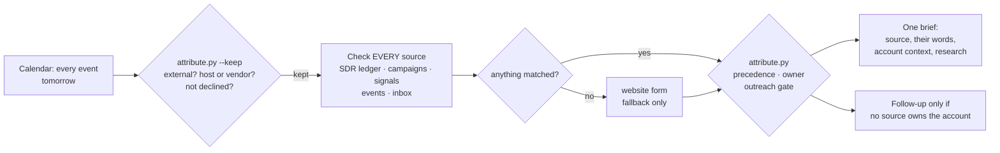

# meeting-source-brief

A Claude Code skill that works out where every meeting actually came from before it researches anyone, then sends one brief for the whole day.

A booking link tells you how someone *scheduled*. It doesn't tell you why they showed up. When you run several lead sources at once (an outsourced SDR, your own campaigns, a signal tool, events, the website), most meetings arrive through the same calendar link, and a brief that trusts the link gets the source wrong. Wrong source means the wrong opener, a double touch on an account someone else is working, and a pipeline report that credits the website for the vendor's work.

This skill checks every source, every time, and lets code decide.

## What it does



1. **Every event, not a keyword search.** Booking titles vary. The kept set is anything with an outside attendee where a host attends, a vendor organized it, or the title looks like a booking. Vendor staff count as internal.
2. **Every source, every time.** It never stops at the first hit. People routinely turn up in two or three sources, and that overlap is the most useful line in the brief.
3. **The website form is a fallback.** It's only checked when nothing else matched. A website booking from someone your SDR vendor has been working is the vendor's meeting. No hits at all is `unknown`, never "website inbound".
4. **Ownership is a rule, not a vibe.** The highest-ranked source that `owns_account` owns the whole company. The brief says "don't contact anyone else at X", and no personal follow-up goes out.
5. **Spelling-proof search.** Vendor ledgers misspell surnames. Searches use a four-letter stem plus the company, because a five-letter stem splits on a dropped letter (`March-` vs `Marce-`). There's a test for exactly that.

The model gathers evidence. `tools/attribute.py` makes the decisions that must not drift between runs: which meetings count, which source wins, who owns the account, and whether outreach is allowed.

## Setup

```bash
cp sources.example.json sources.json   # gitignored
python3 -m unittest discover -s tests  # 17 tests, no dependencies
python3 tools/attribute.py examples/hits.json
```

`sources.json` holds your internal domains, the hosts, the booking-title patterns, and your sources in precedence order, each with a plain-language `how_to_check` the skill follows. Put `SKILL.md` in `~/.claude/skills/meeting-source-brief/` and run it on a schedule the afternoon before.

Example output: [`examples/brief.md`](examples/brief.md).

## Why it exists

The first version keyword-searched the calendar for "Book a meeting" and treated whatever it found as a website inbound. It tagged the CRM that way and sent each prospect a connection request.

On the first day of the rebuilt version, it briefed four meetings. **All four came from the outsourced SDR. None came from the website.** One of them had already been briefed and tagged as a website inbound nine days earlier. He was on his third booking, using a personal address after his work email bounced, and he was the vendor's lead all along. The vendor's ledger spelled two of the four surnames differently from LinkedIn.

None of that is visible from the calendar invite.

## License

MIT
